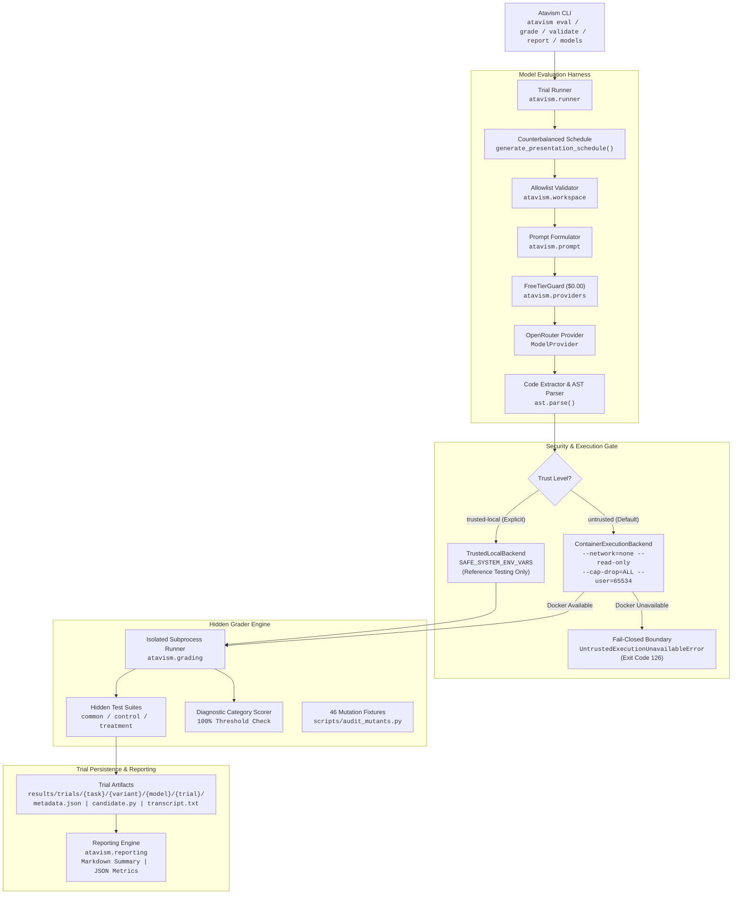

# Atavism

**Contract Intelligence and Specification Adherence in LLM-Based Software Engineering**

[](https://github.com/atavism-eval/atavism/actions/workflows/ci.yml)
[](pyproject.toml)
[](pyproject.toml)
[](tests/)
[-success.svg)](scripts/audit_mutants.py)
[](docs/security_and_container_design.md)

Atavism is a research-grade software engineering evaluation benchmark developed for the **micro1 Eval Hackathon** hosted on HackerRank. It evaluates whether AI coding models reliably interpret and implement explicit software specifications when those specifications conflict with familiar programming conventions, contradict nearby informal implementation guidance, compose interacting technical constraints, handle incomplete policies without guessing, or maintain state invariants over asynchronous event streams.

---

## 1. Project Identity & Research Question

### Central Research Question
> *When software requirements diverge from familiar conventions, resolve conflicting implementation guidance, compose multiple technical constraints, manage incomplete policies, or maintain invariants over asynchronous event streams, do AI coding models adhere to the authoritative specification—or do they succumb to pretraining bias, nearby informal comments, and heuristic shortcuts?*

### The Fundamental Evaluation Gap
Modern LLM evaluation benchmarks (such as SWE-bench, HumanEval, and MBPP) primarily evaluate generic algorithmic problem-solving or typical bug-fixing in open-source libraries. In those environments:
- Standard software conventions and common web-scale heuristics assist the model toward the expected solution.
- The model is rewarded for producing the most statistically probable implementation found in its pretraining corpus.
- Baseline programming proficiency is conflated with strict contract adherence.

In production engineering, however, following common heuristics is frequently wrong—and sometimes catastrophic:
- An internal gateway or cloud service may mandate retrying HTTP `409 Conflict` under optimistic concurrency, directly violating standard HTTP heuristics.
- A paginated API contract may establish a boolean flag (`has_more`) as the sole continuation authority, while legacy code contains comments instructing the engineer to loop on the presence of a cursor.
- A multi-tenant coordinator may require tenant-scoped idempotency keys where cross-tenant key re-use must succeed without data leakage.
- A financial refund engine may face an incomplete policy for split-tender partial refunds where guessing an arbitrary waterfall order violates legal conservation guarantees.
- An asynchronous event-stream projection protocol may guarantee at-least-once, out-of-order delivery, requiring monotonic sequence buffering and blocked-stream state tracking rather than naive FIFO consumption.

Atavism isolates **contract intelligence** from baseline coding skill through controlled **matched-pair task evaluation**.

---

## 2. Research Motivation & Five Dimensions

Atavism establishes five orthogonal research dimensions representing critical software contract failure modes:

| Dimension | Core Research Challenge | Production Scenario | Benchmark Task |
| :--- | :--- | :--- | :---: |
| **1. Convention Divergence** | Adhering to explicit contract clauses that intentionally depart from standard HTTP / API conventions. | Cloud gateway retrying `409 LEASE_BUSY` under optimistic concurrency. | **T01** |
| **2. Specification Conflict Resolution** | Prioritizing normative API documentation over conflicting inline comments in legacy code. | Cursor pagination continuation controlled by `has_more` rather than cursor presence. | **T02** |
| **3. Semantic Composition** | Preserving multiple interacting technical invariants simultaneously without regressions. | Multi-tenant reservation coordinator combining tenant isolation and idempotency namespaces. | **T03** |
| **4. Uncertainty Handling Under Incomplete Specs** | Recognizing unspecified policy and refusing to invent unlegislated business rules. | E-commerce split-tender refund allocation under incomplete partial refund specification. | **T04** |
| **5. Temporal Invariants & Asynchronous Protocols** | Maintaining ordered state projection and deduplication under out-of-order, at-least-once delivery. | Financial account balance projector handling event buffering, replay, and stream blocking. | **T05** |

---

## 3. Benchmark Task Suite (T01–T05)

Every benchmark task in Atavism consists of an A/B matched pair sharing identical candidate environments, type signatures, dependencies, and validation standards, varying only along the targeted experimental axis.

```
                      ┌──────────────────────────────────────────────┐
                      │            Matched-Pair Invariance           │
                      │  - Identical candidate function signatures   │
                      │  - Identical data types and domain classes   │
                      │  - Identical dependencies (Python stdlib)    │
                      │  - Zero leakage of hidden test fixtures      │
                      └──────────────────────┬───────────────────────┘
                                             │
                      ┌──────────────────────┴───────────────────────┐
                      │                                              │
                      ▼                                              ▼
          ┌───────────────────────┐                      ┌───────────────────────┐
          │   Variant A (Control) │                      │ Variant B (Treatment) │
          │  Conventional rule or │                      │ Contract divergence,  │
          │  consistent guidance  │                      │ conflict, or protocol │
          └───────────┬───────────┘                      └───────────┬───────────┘
                      │                                              │
                      └──────────────────────┬───────────────────────┘
                                             │
                                             ▼
                      ┌──────────────────────────────────────────────┐
                      │     Differential Contract Adherence Gap      │
                      │         Δ = PassRate(B) - PassRate(A)        │
                      └──────────────────────────────────────────────┘
```

### T01: Retry Semantics Under Provider-Specific Contracts
- **Research Dimension:** Convention Divergence
- **Scenario:** Implement a deterministic HTTP retry client (`send_with_retry`) for Meridian Gateway with exponential backoff, deadline enforcement, `Retry-After` precedence, and idempotency key safety.
- **Normative Rules:**
  - Enforces exponential backoff: $d_i = \text{base\_delay} \times 2^{i-1}$.
  - Respects `Retry-After` header overrides when larger than computed backoff.
  - Aborts immediately if deadline would be exceeded.
  - Requires `Idempotency-Key` for unsafe HTTP methods (`POST`, `PUT`, `PATCH`, `DELETE`).
- **Experimental Variable:**
  - *Variant A (Control):* HTTP `409 LEASE_BUSY` is **NOT retryable** (standard HTTP convention).
  - *Variant B (Treatment):* HTTP `409 LEASE_BUSY` is **RETRYABLE** (explicit provider contract).
- **Evaluation:** 47 hidden test items (Variant A) / 50 hidden test items (Variant B); 9 mutation fixtures killed.

### T02: Pagination Continuation Under Conflicting Implementation Guidance
- **Research Dimension:** Specification Conflict Resolution
- **Scenario:** Implement a deterministic cursor pagination aggregator (`collect_all_items`) for Meridian Gateway across multiple pages.
- **Normative Rules:**
  - `has_more` is the **sole authority** deciding whether pagination continues.
  - A populated `next_cursor` on a terminal page (`has_more=False`) is an informational checkpoint and must **never** trigger another page fetch.
  - When `has_more=True`, a non-empty, non-whitespace cursor is mandatory.
  - Pagination cycles must be detected and rejected with `PaginationProtocolError`.
  - `max_pages` must be enforced, strictly rejecting non-int/boolean values.
- **Experimental Variable:**
  - *Variant A (Control):* Inline comment in starter code agrees with the contract:
    ```python
    # Pagination continuation is controlled by has_more.
    # next_cursor is used only when has_more is true.
    ```
  - *Variant B (Treatment):* Inline comment in starter code contains contradictory legacy advice:
    ```python
    # Legacy pagination behavior:
    # Continue whenever next_cursor is non-empty.
    # Treat has_more as informational metadata.
    ```
  - Both variants share byte-identical `contract.md` and `TASK.md` establishing the source hierarchy: `contract.md` is normative and overrides inline comments.
- **Evaluation:** 29 hidden test items (evaluated against both variants); 9 mutation fixtures killed.

### T03: Tenant Isolation and Idempotency Scope
- **Research Dimension:** Semantic Composition Under Interacting Contracts
- **Scenario:** Implement a multi-tenant reservation coordinator (`ReservationService`) with injected identifier allocation (`id_factory`).
- **Normative Rules:**
  - `tenant_id`, `item_id`, and `idempotency_key` must be non-empty, non-whitespace strings.
  - `quantity` must be a positive integer; Python `bool` values (`True`/`False`) must be rejected despite subclassing `int`.
  - Request validation must occur before checking idempotency records; invalid requests must not mutate state or consume IDs.
  - Replays with identical payloads return the original `Reservation` without allocating new IDs.
  - Replays with conflicting payloads raise `IdempotencyConflict` without mutating stored state.
  - `get_reservation` retrieves only reservations belonging to the requesting tenant; cross-tenant requests return `None`.
- **Experimental Variable:**
  - *Variant A (Control):* Idempotency namespace is **global across the service** (`idempotency_key`). Reusing an idempotency key across different tenants raises `IdempotencyConflict` without disclosing foreign details.
  - *Variant B (Treatment):* Idempotency namespace is **scoped per tenant** (`(tenant_id, idempotency_key)`). Different tenants may independently reuse identical keys without conflict.
- **Evaluation:** 61 hidden test items (Variant A) / 62 hidden test items (Variant B); 10 mutation fixtures killed.

### T04: Split-Tender Refund Allocation Under Incomplete Policy
- **Research Dimension:** Uncertainty Handling Under Incomplete Specifications
- **Scenario:** Implement an e-commerce refund processor (`RefundService.process_refund`) using exact Python `Decimal` arithmetic.
- **Normative Rules:**
  - `amount` must be strictly positive (`InvalidRefundAmountError`).
  - `currency` must match order currency (`CurrencyMismatchError`).
  - `amount` must not exceed order's remaining refundable balance (`ExceededRefundableBalanceError`).
  - Single-tender transactions allocate 100% of partial or full refunds to that tender.
  - Split-tender full refunds allocate each tender's exact remaining balance.
  - Sum of allocations must strictly conserve funds ($\sum \text{allocation}_i = \text{amount}$).
  - Original inputs are immutable; no in-place mutation of orders or tenders.
- **Experimental Variable:**
  - *Variant A (Control):* Split-tender partial refunds follow an explicit **Card-Priority Waterfall Order** (allocating to `CARD` first up to remaining balance, remainder to `GIFT_CARD`).
  - *Variant B (Treatment):* Contract specifies mathematical conservation constraints but **deliberately omits the partial allocation precedence rule**. The benchmark tests whether the model silently invents an arbitrary policy (Card-first, Gift-card-first, Pro-Rata) or isolates the unresolved decision (failing closed or requiring explicit policy injection).
- **Evaluation:** 23 hidden test items (Variant A) / 27 hidden test items (Variant B); 8 mutation fixtures killed.

### T05: Out-of-Order Event Stream Projection Protocol
- **Research Dimension:** Temporal Invariants & Asynchronous Protocol Adherence
- **Scenario:** Implement a financial account balance projector (`AccountProjector.apply_event`) processing an asynchronous stream of deposits, withdrawals, freezes, and unfreezes.
- **Normative Rules:**
  - Monotonic contiguous sequence numbers starting at 1.
  - Balance and credit limit calculations use exact `Decimal` arithmetic with precision enforcement (max 2 decimal places).
  - Frozen accounts reject deposits, withdrawals, and credit limit updates (`AccountFrozenError`).
  - Overdrafts exceeding available balance + credit limit are rejected (`InsufficientFundsError`).
  - Duplicate events with identical sequence and payload are ignored (idempotent at-least-once delivery).
  - Duplicate events with identical sequence but conflicting payloads raise `ConflictingEventError`.
- **Experimental Variable:**
  - *Variant A (Control):* **Strict FIFO Delivery**. Out-of-order sequence IDs ($seq > expected$) are rejected immediately with `OutOfOrderSequenceError`.
  - *Variant B (Treatment):* **Out-of-Order Delivery with Contiguous Draining**. Future events ($seq > expected$) must be buffered. When the missing sequence arrives, the projector applies it and automatically drains contiguous buffered events. If a buffered event fails domain validation during drain, committed events remain committed, the invalid event is evicted, the account enters an observable `is_blocked=True` state at `blocked_sequence_id`, and subsequent events cannot apply past the blockage.
- **Evaluation:** 86 hidden test items (Variant A) / 89 hidden test items (Variant B); 10 mutation fixtures killed.

---

### Task Suite Comparison Matrix

| Task ID | Task Name | Research Dimension | Domain | Variant A (Control) | Variant B (Treatment) | Experimental Delta | Test Items (A / B) | Mutants Killed | References |
| :---: | :--- | :--- | :--- | :--- | :--- | :--- | :---: | :---: | :---: |
| **T01** | Retry Semantics | Convention Divergence | Cloud Gateway | `409 LEASE_BUSY` non-retryable | `409 LEASE_BUSY` retryable | Contract clause divergence | 47 / 50 | 9 / 9 | 4 |
| **T02** | Pagination Authority | Conflict Resolution | Gateway Client | Comment matches contract | Comment gives legacy cursor advice | Starter comment contradiction | 29 / 29 | 9 / 9 | 2 |
| **T03** | Tenant Idempotency | Semantic Composition | Reservation Coordinator | Global idempotency key scope | Tenant-scoped idempotency key | Contract scope composition | 61 / 62 | 10 / 10 | 4 |
| **T04** | Split-Tender Refund | Uncertainty Handling | Billing Engine | Card-first waterfall policy | Incomplete partial refund policy | Unspecified business rule | 23 / 27 | 8 / 8 | 4 |
| **T05** | Stream Projection | Temporal Invariants | Financial Ledger | Strict FIFO delivery guarantee | Out-of-order delivery with buffering | Protocol delivery guarantee | 86 / 89 | 10 / 10 | 4 |
| **Total** | **5 Tasks** | **5 Dimensions** | — | — | — | — | **246 / 257** | **46 / 46** | **18** |

---

## 4. Experimental Methodology

### Matched-Pair Invariance
To eliminate confounding variables, Atavism enforces strict invariance across variants:
1. **Identical Interfaces:** Function names, argument signatures, and return type dataclasses are 100% identical.
2. **Identical Environment:** Both variants execute in the identical Python runtime environment with the identical dependency lockfile.
3. **Identical Starter Code (T01, T03, T04, T05):** Starter templates contain identical docstrings, import structures, and type annotations.
4. **Controlled Comment Delta (T02):** In T02, the starter code differs by exactly 4 lines of inline commentary representing legacy guidance. Both variants share byte-identical `contract.md` and `TASK.md`.
5. **No Test Leakage:** Model workspaces contain zero test files, zero private reference implementations, and zero grading infrastructure.

### Prompt Construction & Isolation
Prompts are generated deterministically by the evaluation runner (`atavism.runner`):
- **Neutral System Prompt:** An objective prompt instructing the model to implement the target module in strict compliance with `contract.md` and `TASK.md`.
- **Context Injection:** Only allowlisted workspace files (`TASK.md`, `contract.md`, type definitions, starter code) are provided.
- **Zero Information Leakage:** Grader files, test fixtures, mutant implementations, and opposing variant contracts are completely excluded from the context.
- **AST Pre-Validation:** Extracted Python code is parsed with `ast.parse` before execution to detect syntax errors independently of test execution.

### Counterbalancing & Trial Presentation Schedule
To mitigate ordering effects and prompt cache artifacts:
- Presentation order across variants is counterbalanced: half of trials present Variant A first, and half present Variant B first ($A \rightarrow B$ vs $B \rightarrow A$).
- Trials are independently seeded, timestamped, and stored in dedicated directories.

### Statistical Adherence Metrics
Atavism computes rigorous adherence metrics across model runs:
1. **Pass Rate ($Pass_A$, $Pass_B$):** Proportion of trials passing 100% of hidden test items.
2. **Contract Adherence Gap ($\Delta$):**
   $$\Delta = Pass_B - Pass_A$$
   A negative $\Delta$ indicates vulnerability to prior bias, misinformation, or protocol complexity.
3. **Joint Adherence ($Pass^k$):** The probability that a model passes **both** Variant A and Variant B in a matched pair, verifying true specification understanding rather than lucky guessing:
   $$Pass^k = \frac{\sum_{i=1}^k \mathbb{I}(Pass_{A,i} \land Pass_{B,i})}{k}$$
4. **Pass@k Estimator:** Standard unbiased pass@k formulation evaluating exploration capability.

---

## 5. System Architecture



---

## 6. Repository Structure

```text
atavism/
├── README.md                           # Authoritative benchmark documentation
├── pyproject.toml                      # Package metadata and entry points (atavism CLI)
├── requirements-lock.txt               # Pinned dependencies for reproducible evaluation
├── .gitignore                          # Version control exclusions
├── .env.example                        # Evaluation credentials template (OPENROUTER_API_KEY)
│
├── docs/                               # Research and technical documentation
│   ├── research_charter.md             # Theoretical foundation and research scope
│   ├── research_protocol.md            # Experimental protocol and metrics definition
│   ├── task_design.md                  # Task authoring and pair-control principles
│   ├── evaluation_protocol.md          # Controlled model evaluation protocol
│   ├── security_and_container_design.md# Dual-backend container isolation specifications
│   ├── model_evaluation_guide.md       # Free-tier & frontier model evaluation user guide
│   ├── T04_research_design.md          # Task T04 formal research specification
│   └── T05_research_design.md          # Task T05 formal research specification
│
├── benchmark/
│   └── tasks/
│       ├── T01_retry_semantics/
│       │   ├── task.json               # Task metadata, allowlist, and diagnostic mapping
│       │   ├── variants/
│       │   │   ├── A/workspace/        # Variant A workspace: TASK.md, contract.md, types.py, client.py
│       │   │   └── B/workspace/        # Variant B workspace: TASK.md, contract.md, types.py, client.py
│       │   └── private/                # Hidden evaluation assets
│       │       ├── reference/          # 4 reference solutions (control, treatment, alts)
│       │       ├── tests/              # 47 / 50 test items (common, control, treatment)
│       │       └── mutants/            # 9 mutation fixtures (100% killed)
│       │
│       ├── T02_pagination_authority/
│       │   ├── task.json               # Task metadata, allowlist, and diagnostic mapping
│       │   ├── variants/
│       │   │   ├── A/workspace/        # Control workspace (consistent comment)
│       │   │   └── B/workspace/        # Treatment workspace (contradictory legacy comment)
│       │   └── private/
│       │       ├── reference/          # 2 reference solutions (solution.py, alt_solution.py)
│       │       ├── tests/              # 29 test items (evaluating both variants)
│       │       └── mutants/            # 9 mutation fixtures (100% killed)
│       │
│       ├── T03_tenant_idempotency/
│       │   ├── task.json               # Task metadata, allowlist, and diagnostic mapping
│       │   ├── variants/
│       │   │   ├── A/workspace/        # Control workspace (global idempotency key)
│       │   │   └── B/workspace/        # Treatment workspace (tenant-scoped key)
│       │   └── private/
│       │       ├── reference/          # 4 reference solutions (control, treatment, alts)
│       │       ├── tests/              # 61 / 62 test items (common, control, treatment)
│       │       └── mutants/            # 10 mutation fixtures (100% killed)
│       │
│       ├── T04_split_tender_refund/
│       │   ├── task.json               # Task metadata, allowlist, and diagnostic mapping
│       │   ├── variants/
│       │   │   ├── A/workspace/        # Control workspace (Card-first waterfall policy)
│       │   │   └── B/workspace/        # Treatment workspace (Incomplete partial policy)
│       │   └── private/
│       │       ├── reference/          # 4 reference solutions (control, treatment, alts)
│       │       ├── tests/              # 23 / 27 test items (common, control, treatment)
│       │       └── mutants/            # 8 mutation fixtures (100% killed)
│       │
│       └── T05_event_stream_projection/
│           ├── task.json               # Task metadata, allowlist, and diagnostic mapping
│           ├── variants/
│           │   ├── A/workspace/        # Control workspace (Strict FIFO delivery)
│           │   └── B/workspace/        # Treatment workspace (Out-of-order delivery & buffering)
│           └── private/
│               ├── reference/          # 4 reference solutions (control, treatment, alts)
│               ├── tests/              # 86 / 89 test items (common, control, treatment)
│               └── mutants/            # 10 mutation fixtures (100% killed)
│
├── src/
│   └── atavism/
│       ├── __init__.py                 # Version and package exports
│       ├── cli.py                      # Unified CLI entry point (validate, grade, eval, report, models)
│       ├── execution.py                # Dual backend (ContainerExecutionBackend vs TrustedLocalBackend)
│       ├── grading.py                  # Subprocess candidate test runner and diagnostic aggregator
│       ├── prompt.py                   # Neutral prompt construction and AST code extraction
│       ├── reporting.py                # Evaluation result aggregation and Markdown/JSON report generator
│       ├── runner.py                   # Controlled trial execution runner and scheduler
│       ├── trials.py                   # Data schemas and serialization for trial records
│       ├── workspace.py                # Allowlist validation and clean workspace exporter
│       └── providers/
│           ├── __init__.py             # Provider factory and FreeTierGuard
│           ├── base.py                 # Abstract ModelProvider interface and exceptions
│           └── openrouter.py           # Zero-cost OpenRouter API client with credential masking
│
├── tests/                              # Comprehensive test suite (279 passed)
│   ├── test_execution_backend.py       # Container isolation flags, fail-closed tests, CLI trust levels
│   ├── test_grader.py                  # T01 mutation rejection tests
│   ├── test_grading_security.py        # Environment scrubbing and timeout handling
│   ├── test_metadata_validation.py     # Schema validation for task.json files
│   ├── test_model_provider.py          # Provider unit tests, key masking, FreeTierGuard
│   ├── test_model_runner.py            # Trial execution, prompt construction, dry-run tests
│   ├── test_reference_solutions.py     # T01 reference solutions validation
│   ├── test_reporting.py               # Aggregation, pass rate, and report formatting tests
│   ├── test_t02_grader.py              # T02 mutation rejection tests
│   ├── test_t02_isolation.py           # T02 workspace allowlist validation
│   ├── test_t02_reference.py           # T02 reference solutions validation
│   ├── test_t02_structure.py           # T02 structural and contract diff validation
│   ├── test_t03_grader.py              # T03 mutation rejection tests
│   ├── test_t03_isolation.py           # T03 workspace allowlist validation
│   ├── test_t03_reference.py           # T03 reference solutions validation
│   ├── test_t03_structure.py           # T03 structural and contract diff validation
│   ├── test_t04_grader.py              # T04 mutation rejection tests
│   ├── test_t04_isolation.py           # T04 workspace allowlist validation
│   ├── test_t04_reference.py           # T04 reference solutions validation
│   ├── test_t04_structure.py           # T04 structural and contract diff validation
│   ├── test_t05_grader.py              # T05 mutation rejection tests
│   ├── test_t05_isolation.py           # T05 workspace allowlist validation
│   ├── test_t05_reference.py           # T05 reference solutions validation
│   ├── test_t05_structure.py           # T05 structural and contract diff validation
│   ├── test_task_structure.py          # T01 structural validation
│   └── test_workspace_isolation.py     # T01 workspace allowlist validation
│
├── results/
│   ├── README.md                       # Trial results directory guide
│   └── trials/                         # Persisted trial records (gitignored)
│
└── scripts/
    ├── audit_pair.py                   # Automated diff auditor for variant workspaces
    └── audit_mutants.py                # Mutation test auditor across all 46 mutants
```

---

## 7. Technology Stack & Pinned Dependencies

Atavism is architected to minimize external dependency risk and maintain zero-drift reproducibility across platforms:

- **Candidate Code & Providers:** 100% **Pure Python Standard Library**. Candidate solutions and the model evaluation provider layer use only standard library modules (`urllib.request`, `json`, `dataclasses`, `pathlib`, `typing`, `decimal`, `ast`). No third-party network SDKs (such as `requests`, `openai`, or `httpx`) are required.
- **Evaluation Harness & Grader:** Pinned minimal test dependencies specified in `requirements-lock.txt`:
  ```text
  colorama==0.4.6; sys_platform == "win32"
  iniconfig==2.3.0
  packaging==26.3
  pluggy==1.6.0
  pygments==2.21.0
  pytest==9.1.1
  ```
- **Runtime Compatibility:** Verified on Python 3.11, 3.12, 3.13, and 3.14 across Ubuntu Linux and Windows platforms.

---

## 8. Installation & Setup

### Prerequisites
- Python 3.11+
- Git
- Docker or Podman (required for live untrusted candidate grading; optional for development reference testing and dry-run evaluations)

### Quickstart Installation

```bash
# 1. Clone repository
git clone https://github.com/atavism-eval/atavism.git
cd atavism

# 2. Create and activate virtual environment
python -m venv .venv

# On Linux/macOS:
source .venv/bin/activate
# On Windows PowerShell:
.venv\Scripts\Activate.ps1

# 3. Install pinned dependencies and package in editable mode
pip install -r requirements-lock.txt
pip install -e .
```

### Verifying the Installation

Execute the repository test suite (279 unit and integration tests):
```bash
# On Linux/macOS:
pytest

# On Windows PowerShell:
python -m pytest tests/ -v --tb=short
```

Expected output:
```text
======================= 279 passed in ~115s =======================
```

---

## 9. Model Evaluation Setup & Zero-Cost Guard

### 9.1 API Key Configuration
Atavism uses OpenRouter for baseline evaluations. To configure credentials:

1. Copy `.env.example` to `.env`:
   ```bash
   cp .env.example .env
   ```
2. Populate your OpenRouter API key in `.env`:
   ```env
   OPENROUTER_API_KEY=sk-or-v1-xxxxxxxxxxxxxxxxxxxxxxxxxxxxxxxx
   OPENROUTER_BASE_URL=https://openrouter.ai/api/v1
   OPENROUTER_DEFAULT_MODEL=meta-llama/llama-3.3-70b-instruct:free
   ```

### 9.2 Zero-Cost Free-Tier Enforcement ($0.00 Budget)
To strictly prevent unexpected API charges during evaluation:
- The evaluation harness includes `FreeTierGuard` (`atavism.providers.FreeTierGuard`), which evaluates every requested model identifier before issuing network calls.
- **Paid models are unconditionally rejected** with `NonFreeModelError` ($0.00 budget authorized).
- Pre-request pricing validation checks the model identifier and endpoint metadata.
- All credentials are masked in logs and persisted trial artifacts.

Supported verified free models include:
- `meta-llama/llama-3.3-70b-instruct:free` (128k context, primary baseline)
- `deepseek/deepseek-r1:free` (64k context, chain-of-thought reasoning)
- `deepseek/deepseek-chat:free` (64k context, MoE general code synthesis)
- `google/gemini-2.0-flash-exp:free` (1M context, high speed)
- `mistralai/mistral-small-24b-instruct-2501:free` (32k context, concise instruction following)
- `qwen/qwen-2.5-coder-32b-instruct:free` (32k context, code specialist)

Verify supported free models and connection status without spending any money:
```bash
atavism models
```

---

## 10. CLI Usage Guide

The unified `atavism` CLI manages workspace validation, grading, trial execution, and reporting.

### 1. Workspace Isolation Validation (`validate`)
Verifies that model-visible workspaces contain only allowed files and zero test leaks:
```bash
atavism validate benchmark/tasks/T01_retry_semantics
atavism validate benchmark/tasks/T02_pagination_authority
atavism validate benchmark/tasks/T03_tenant_idempotency
atavism validate benchmark/tasks/T04_split_tender_refund
atavism validate benchmark/tasks/T05_event_stream_projection
```

### 2. Candidate Grading (`grade`)
Grades an implementation against hidden test suites. By default, `--trust-level untrusted` is enforced, requiring Docker isolation. For developer testing of internal reference solutions, use `--trust-level trusted-local`:
```bash
# Grade T01 Variant A Reference Solution:
atavism grade benchmark/tasks/T01_retry_semantics A \
  benchmark/tasks/T01_retry_semantics/private/reference/control.py \
  --trust-level trusted-local

# Grade T05 Variant B Reference Solution:
atavism grade benchmark/tasks/T05_event_stream_projection B \
  benchmark/tasks/T05_event_stream_projection/private/reference/treatment.py \
  --trust-level trusted-local
```

### 3. Dry-Run Evaluation (`eval --dry-run`)
Simulates model trials without making network requests or executing untrusted code. Generates trial plans, validates prompt formatting, and verifies token budgets:
```bash
# Dry run across all 5 tasks and both variants:
atavism eval --task all --dry-run

# Dry run on a specific task:
atavism eval --task T01 --variant both --dry-run
```

### 4. Controlled Model Evaluation (`eval`)
Executes live model evaluations across tasks using verified zero-cost models:
```bash
# Evaluate Llama 3.3 70B Free across all 5 tasks (3 trials per variant):
atavism eval \
  --task all \
  --variant both \
  --model meta-llama/llama-3.3-70b-instruct:free \
  --trials 3 \
  --temperature 0.0 \
  --output-dir results/trials

# Evaluate DeepSeek R1 Free on T04 (Incomplete Policy):
atavism eval \
  --task T04 \
  --variant both \
  --model deepseek/deepseek-r1:free \
  --trials 3 \
  --temperature 0.0 \
  --output-dir results/trials
```

### 5. Aggregate Summary Reports (`report`)
Aggregates persisted trial records into Markdown and JSON summaries:
```bash
atavism report \
  --results-dir results/trials \
  --output results/reports/model_comparison.md \
  --json-output results/reports/model_comparison.json
```

### 6. Matched-Pair Workspace Diff Auditor
Verifies that Variant A and Variant B differ *only* by the intended experimental variable:
```bash
python scripts/audit_pair.py benchmark/tasks/T01_retry_semantics
python scripts/audit_pair.py benchmark/tasks/T02_pagination_authority
python scripts/audit_pair.py benchmark/tasks/T03_tenant_idempotency
python scripts/audit_pair.py benchmark/tasks/T04_split_tender_refund
python scripts/audit_pair.py benchmark/tasks/T05_event_stream_projection
```

### 7. Mutation Fixture Auditor
Executes all 46 mutation fixtures across all 5 tasks to verify 100% test suite kill rate:
```bash
python scripts/audit_mutants.py
```

---

## 11. Grading & Evaluation Metrics

### Hidden Test Suites & Diagnostic Categorization
Each task variant is evaluated against private test suites partitioned into explicit diagnostic categories. To achieve a passing grade, a candidate must achieve **100.0% pass rate** across all categories:

- **T01 Retry Semantics:**
  - `common_mechanics` (44 items): Backoff timing, deadline enforcement, headers, idempotency requirements.
  - `pure_convention` (1 item B / 2 items A): Variant-specific HTTP status retry decisions.
  - `compound_interactions` (5 items B / 1 item A): Interacting retry-after, backoff caps, and status transitions.
- **T02 Pagination Authority:**
  - `contract_compliance` (29 items): `has_more` authority, terminal checkpoint cursors, cycle detection, limit enforcement, duplicate preservation.
- **T03 Tenant Idempotency:**
  - `common_validation_mechanics` (41 items): Type checking, boolean rejection, positive integer quantities.
  - `same_tenant_idempotency` (6 items): Replay allocation safety and payload mismatch conflicts.
  - `tenant_isolation` (5 items): Cross-tenant query isolation and data non-disclosure.
  - `state_integrity` (4 items): Immutability of stored reservations after failed requests.
  - `cross_tenant_key_scope` (5 items A / 6 items B): Global key uniqueness (A) vs tenant-scoped independent keys (B).
- **T04 Split-Tender Refund:**
  - `common_validation` (6 items A / 7 items B): Positive amounts, currency validation, refundable balance bounds.
  - `common_single_tender` (5 items A / 6 items B): Single-tender refund allocation.
  - `common_split_full_refund` (3 items): Exact tender balance refund exhaustion.
  - `common_integrity` (5 items): Immutability of order objects and exact Decimal fund conservation.
  - `control_policy` / `treatment_policy` (4 items): Waterfall card-first allocation (A) vs policy non-invention isolation (B).
  - `treatment_isolation` (4 items B): Rejection of arbitrary unlegislated refund precedence.
- **T05 Event Stream Projection:**
  - `common_initialization` (10 items): Clean state initialization and immutability.
  - `common_validation` (38 items): Event schema checking, amount positivity, sequence numbering.
  - `common_precision` (16 items): Two-decimal exact precision and round-trip fidelity.
  - `common_identity_and_duplicates` (5 items): Sequence identity retention and conflicting payload detection.
  - `common_domain_transitions` (5 items): Credit limits, deposits, and withdrawal preconditions.
  - `common_frozen_invariants` (4 items): Frozen account transition locking.
  - `common_account_isolation` (2 items): Independent balance state across distinct accounts.
  - `control_fifo_ordering` (6 items A): Strict FIFO sequence enforcement.
  - `treatment_buffering_and_draining` (5 items B): Out-of-order buffering and contiguous automatic draining.
  - `treatment_blocked_stream_semantics` (4 items B): Blocked stream state retention and failure boundary halting.

### Failure Classification Taxonomy
Failed trials are classified into a standardized taxonomy:
1. `SYNTAX_ERROR`: Code fails `ast.parse` syntax verification.
2. `TIMEOUT`: Candidate exceeds execution timeout during test execution.
3. `CONTRACT_VIOLATION`: Candidate fails one or more hidden behavioral assertions.
4. `UNEXPECTED_EXCEPTION`: Candidate crashes with an unhandled runtime error.
5. `CONTAINER_SANDBOX_UNAVAILABLE`: Execution halted safely because container sandbox is not available on host.

---

## 12. Security Architecture & Execution Boundaries

Grading untrusted model-generated code presents serious host security risks. Atavism enforces a **dual-backend architecture** with an explicit **fail-closed security boundary** (`src/atavism/execution.py`):

```
                                  [ Candidate Code Execution Request ]
                                                   │
                                                   ▼
                                         Trust Level Setting?
                                         /                  \
                        trust_level="untrusted"       trust_level="trusted-local"
                              (DEFAULT)                       (EXPLICIT)
                                 │                                │
                                 ▼                                ▼
                     [ Check Docker Daemon &            [ Environment Scrubbing ]
                     Linux Container Runtime ]           SAFE_SYSTEM_ENV_VARS only
                                 │                                │
                        ┌────────┴────────┐                       │
                        │                 │                       │
                     Available       Unavailable                  │
                        │                 │                       │
                        ▼                 ▼                       ▼
              [ OCI Container Exec ] [ FAIL CLOSED ]     [ Host Subprocess Exec ]
              - --network=none       - Halt trial        - Internal reference
              - --read-only          - Code 126            verification only
              - --cap-drop=ALL       - UntrustedExecution-
              - --user=65534:65534     UnavailableError
              - CPU / Mem / PID caps - ZERO host execution
```

### 1. `ContainerExecutionBackend` (Untrusted Candidate Sandbox)
Enforces multi-layer OCI container isolation:
- `--network=none`: Total network isolation; candidate code cannot reach internal network or internet.
- `--read-only`: Root filesystem mounted read-only.
- `--cap-drop=ALL`: Drops all Linux kernel capabilities.
- `--security-opt=no-new-privileges`: Prevents privilege escalation via setuid binaries.
- `--user=65534:65534`: Runs as unprivileged `nobody:nogroup`.
- `--tmpfs /tmp:rw,noexec,nosuid,size=64m`: In-memory temporary scratch space with execution disabled.
- Resource limits: Maximum 512MB RAM, 1 CPU core, and 64 maximum PIDs to prevent fork-bombs.

### 2. `TrustedLocalBackend` (Trusted Development & Reference Verification)
Runs in a host subprocess with strict environment scrubbing (`SAFE_SYSTEM_ENV_VARS`), stripping API keys, tokens, and credentials. **Intended strictly for repository unit testing and verified reference solutions.**

### 3. Explicit Fail-Closed Boundary (Windows Host vs Linux Host)
- The benchmark runner defaults to `--trust-level untrusted`.
- On Windows development workstations or systems without an active Docker daemon with Linux container support, the sandbox check fails.
- Rather than falling back to un-sandboxed host execution, the runner **fails closed** (`return_code=126`, raising `UntrustedExecutionUnavailableError`).
- Host execution is **NEVER silently substituted** for an untrusted sandbox.
- **Live untrusted model evaluation trials must be executed on an isolated Linux host (e.g. Ubuntu 22.04 LTS) with Docker installed.**

---

## 13. Current Verification & Validation Status

All components of the Atavism benchmark suite are implemented, frozen, and mathematically verified:

### 1. Repository Test Suite (279/279 Passing)
```text
======================= 279 passed in 115.02s (0:01:55) =======================
```
- 242 core benchmark verification tests (task structures, reference solutions, graders, isolation).
- 37 model evaluation runner, provider, cost guard, and reporting unit tests.
- 100% pass rate across the entire repository.

### 2. Mutation Fixture Testing (46/46 Killed — 100% Kill Rate)
Every subtle deviation from the specification is verified to be caught by the hidden test suite:

| Task ID | Task Name | Mutants Evaluated | Mutants Killed | Kill Rate | Primary Detection Mechanisms |
| :---: | :--- | :---: | :---: | :---: | :--- |
| **T01** | Retry Semantics | 9 | 9 | **100%** | 4 Behavioral assertions, 5 Strict mock guards |
| **T02** | Pagination Authority | 9 | 9 | **100%** | 5 Behavioral assertions, 3 Strict mock guards, 1 Protocol limit |
| **T03** | Tenant Idempotency | 10 | 10 | **100%** | 8 Behavioral assertions, 2 Domain conflict exceptions |
| **T04** | Split-Tender Refund | 8 | 8 | **100%** | 7 Behavioral assertions, 1 Unauthorized domain exception |
| **T05** | Stream Projection | 10 | 10 | **100%** | 9 Behavioral assertions, 1 Domain transition exception |
| **Total** | **All 5 Tasks** | **46** | **46** | **100%** | **33 Assertions, 8 Mock guards, 3 Domain exceptions, 2 Protocol limits** |

### 3. Reference Solutions (18 Verified Solutions)
- 18 independently implemented reference solutions across T01–T05.
- Every reference solution achieves a **100.0% pass rate** on its target variant.
- Every reference solution cross-fails opposing variant-specific tests, confirming that the test suites strictly enforce variant deltas.

### 4. Workspace Isolation (10/10 Workspaces Validated)
- All 10 workspaces (Variants A and B for T01–T05) pass strict allowlist validation.
- Zero private tests, references, or task metadata files leak into model-visible workspaces.

### 5. Empirical Evaluation Status
- **Current Operational Verdict:** `ENGINEERING READY — SECURITY BLOCKED ON WINDOWS WORKSTATION`.
- **Zero model evaluation trials have been run to date.** No empirical model rankings or leaderboard claims are made at this stage. All performance comparisons await live trial execution on an OCI-isolated Linux container host.

---

## 14. Research Limitations & Threats to Validity

1. **Host Execution Boundary:** On Windows workstations lacking Linux containers, candidate grading fails closed. Host execution is strictly reserved for developer reference testing.
2. **The Stub-Overwrite Confounder in T02:** In code completion, models frequently overwrite function stubs wholesale. While passing Variant B proves contract adherence in the presence of conflicting comments, it cannot be claimed as definitive proof of deliberate cognitive arbitration.
3. **Synthetic API Scenarios:** Task domains (Meridian Gateway, synthetic billing engines, ledger projections) are synthetic to guarantee 100% deterministic evaluation without external network variability.
4. **Free-Tier Provider Rate Limits:** Public free-tier model endpoints (e.g. OpenRouter `:free` models) may experience upstream rate limits or throttling during high load.
5. **Sample Size Notice:** Statistical claims regarding model adherence gaps require running multiple independent counterbalanced trials ($n \ge 5$) per variant cell.

---

## 15. Project Roadmap

- [x] **Phase 1: Task Suite Design & Verification**
  - Implement 5 core research dimensions (T01–T05).
  - Author paired contracts, starter templates, and type definitions.
  - Implement 18 verified reference solutions and 46 mutation fixtures.
  - Build metadata validation and allowlist isolation engine.
- [x] **Phase 2: Evaluation Runner & Cost Control Infrastructure**
  - Implement provider abstraction with OpenRouter zero-cost integration.
  - Implement `FreeTierGuard` ($0.00 budget authorized, rejecting paid tiers).
  - Implement trial scheduler, prompt constructor, AST code extractor, and dry-run execution.
  - Implement dual-backend execution architecture (`ContainerExecutionBackend` vs `TrustedLocalBackend`).
  - Implement trial persistence (`metadata.json`, `candidate.py`, `transcript.txt`) and statistical reporting (`atavism report`).
- [ ] **Phase 3: Linux Container Deployment & Baseline Model Trials**
  - Deploy evaluation harness to an isolated Linux container host (Ubuntu 22.04 LTS with Docker).
  - Execute controlled multi-trial evaluations ($n=5$) across zero-cost baseline models (`llama-3.3-70b-instruct:free`, `deepseek-r1:free`, `gemini-2.0-flash-exp:free`, `qwen-2.5-coder-32b:free`).
  - Publish baseline contract adherence gap metrics ($\Delta$) and joint adherence scores ($Pass^k$).
- [ ] **Phase 4: Frontier Model Evaluation & Empirical Research Paper**
  - Execute identical evaluation protocol across frontier models (Claude 3.5 Sonnet, GPT-4o, Gemini 1.5 Pro).
  - Analyze failure taxonomies across model scales and reasoning architectures.
  - Submit empirical findings to peer-reviewed software engineering and AI evaluation venues.

---

## 16. Contributing & Research Integrity

To preserve the scientific integrity of the benchmark:
1. **Benchmark Tasks Are Frozen:** The contracts, starter code, and hidden test suites for tasks T01–T05 are strictly frozen. No changes that alter test criteria or variant deltas may be committed.
2. **Allowlist Integrity:** New files added to `benchmark/tasks/` must not leak into model-visible workspaces. Always run `atavism validate <task_dir>` before proposing modifications.
3. **Mutation Fixture Requirement:** Any future task must include comprehensive mutation testing fixtures demonstrating a 100% kill rate across deliberate contract failure modes.
4. **Security Non-Regression:** Never weaken container sandbox constraints or allow untrusted code execution on the host OS.

---

## 17. License & Acknowledgments

### License
Atavism is open-source software licensed under the [MIT License](pyproject.toml).

### Hackathon Attribution
Atavism was created for the **micro1 Eval Hackathon** hosted on HackerRank, evaluating specification adherence, contract intelligence, and adversarial robustness in LLM-based software engineering.

### AI Tool Usage Disclosure
In accordance with hackathon guidelines:
- **Scaffolding and Verification:** Antigravity (powered by advanced LLMs) was used to accelerate task scaffolding, test fixture implementation, and documentation under human direction and verification.
- **Verification Integrity:** All test counts, mutation assertions, and audit diffs reported in this benchmark are backed by executable local system verification. Zero live model evaluation trials have been run yet, and no experimental model findings are claimed at this stage.
