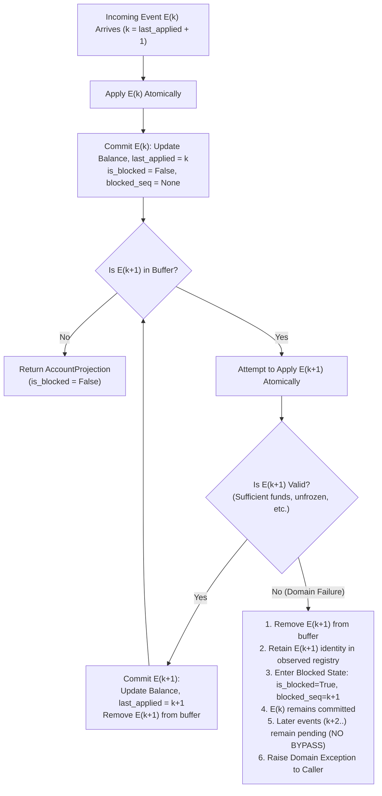

# Atavism T05 — Research Design: Temporal Invariants and Asynchronous Protocol Adherence Under Out-of-Order Event Delivery

**Document Version:** 2.3.0-PROPOSAL (Final State-Machine Consistency Correction — Implementation Target)  
**Task Identifier:** `T05`  
**Task Title:** `Out-of-Order Event Stream Projection Protocol`  
**Research Dimension:** `Temporal Invariants and Asynchronous Protocol Adherence`  
**Status:** PROPOSED — Final Design-Only Revision (Pending Human Approval; No implementation files created or modified)  

---

## 1. Research Question and Scope

### 1.1 Central Research Question
> When an event-delivery contract transitions from guaranteed strict FIFO delivery to out-of-order, at-least-once delivery, can an AI coding model preserve state projection consistency by correctly implementing causal buffering, monotonic sequence advancement, duplicate deduplication, and blocked-stream failure semantics?

### 1.2 Research Scope
Modern cloud and distributed architectures (e.g., partitioned event logs, message brokers, webhook endpoints) frequently deliver messages out of order due to network retries, parallel consumers, and partition rebalancing. In contrast, procedural programming tutorials and textbook coding benchmarks almost universally assume synchronous, in-order execution.

T05 evaluates whether an AI coding model recognizes and adheres to **temporal delivery contracts**:
- In **Control A**, the model operates under a **Strict FIFO, At-Least-Once Delivery** transport contract: first-time delivery of new events must follow contiguous sequence order ($k+1$), while previously delivered events may be redelivered at any time.
- In **Treatment B**, the model operates under an **Out-of-Order, At-Least-Once Delivery** transport contract: both new and previously delivered events may arrive out of order, requiring causal buffering and deterministic ordered draining.

### 1.3 Scope Boundaries & Non-Goals
To preserve construct validity and avoid confounding variables, T05 is strictly scoped:
- **Synthetic in-memory state projection:** Zero network sockets, zero distributed brokers, zero databases, zero multithreading, and zero wall-clock timing.
- **Pure deterministic evaluation:** All operations use Python `Decimal` arithmetic and synchronous method calls.
- **Observable contract adherence:** The benchmark measures observable outputs, state snapshots, and exceptions. It makes **no claims** regarding the model's internal cognitive states, consciousness, or mental awareness.

---

## 2. Experimental Rationale and Hypotheses

### 2.1 Experimental Rationale
Existing software benchmarks (e.g., HumanEval, SWE-bench) evaluate models on standalone algorithms or local repository bug-fixes. They do not evaluate whether a model can navigate **temporal protocol shifts** where the same domain logic must be composed with an asynchronous buffering mechanism.

T05 isolates this capability through a matched control–treatment pair: both variants share 100% identical domain validation, account lifecycles, monetary rules, and duplicate detection semantics. The **sole intended experimental variable** is whether out-of-sequence events must be rejected as protocol violations (Control A) or causally buffered and drained (Treatment B).

### 2.2 Exploratory Hypotheses
Rather than asserting arbitrary percentage thresholds, T05 adopts an exploratory statistical framing:
- **Research Hypothesis ($H_1$):** When evaluated on Treatment B, AI coding models will exhibit an "in-order arrival bias"—defaulting to immediate event processing or dropping future events rather than implementing causal buffering and ordered draining—leading to a significant drop in cross-variant pass rate ($\Delta_{\text{PassRate}} = \text{PassRate}_B - \text{PassRate}_A < 0$).
- **Null Hypothesis ($H_0$):** Under matched prompting conditions, AI coding models demonstrate calibrated protocol adherence, showing no significant difference in contract satisfaction between in-order FIFO contracts and out-of-order buffering contracts ($\Delta_{\text{PassRate}} \approx 0$).

---

## 3. Complete Common Domain Contract

The following domain rules are normative, complete, and **100% identical** across Variant A and Variant B.

### 3.1 Account Lifecycle & `ACCOUNT_OPENED` Rules
1. **Creation Sequence & Invariant:** An account lifecycle begins with an `ACCOUNT_OPENED` event. The `sequence_id` of `ACCOUNT_OPENED` must be strictly `1`.
2. **Initial Balance & Projection State:** The opening event must specify a non-negative finite initial balance (`amount >= Decimal("0.00")`) having at most two fractional decimal places. An initial balance of zero is valid. An opened account initially has `balance = amount`, `is_frozen = False`, `last_applied_sequence = 1`, `pending_buffer_count = 0`, `is_blocked = False`, and `blocked_sequence_id = None`.
3. **Unopened Account Sequence Validation:** If an unopened account receives an `ACCOUNT_OPENED` event with `sequence_id > 1`, it violates the opening schema invariant (an account can only be opened at sequence ID 1) and MUST raise `EventValidationError`. It must not create partial account state or allocate pending buffers.
4. **Pre-Creation Non-Opening Event Rejection:** Any non-opening event (`FUNDS_DEPOSITED`, `FUNDS_WITHDRAWN`, `ACCOUNT_FROZEN`) received for an unopened account must fail immediately with `AccountNotOpenedError`, whether arriving with `sequence_id = 1` or `sequence_id > 1`.
5. **Reconciled Opening Duplicate & Reopening Rules:**
   - **Identical Opening Redelivery:** If an already-opened account receives an `ACCOUNT_OPENED` event with `sequence_id == 1` and an identical payload (matching initial balance and reason `None`), it is an idempotent duplicate. It must not alter state and returns the current `AccountProjection`.
   - **Conflicting Opening Payload at Sequence 1:** If an `ACCOUNT_OPENED` event arrives with `sequence_id == 1` but a conflicting payload (different initial balance or non-None reason), it must raise `ConflictingEventError`. State remains untouched.
   - **Reopening Prohibited:** Once created, an account can never be reopened. Any subsequent `ACCOUNT_OPENED` event received for an existing account with `sequence_id > 1` is an invalid attempt to reopen an account and MUST raise `AccountAlreadyOpenedError`.

### 3.2 Event Schema & Typed Validation Rules
Every event in the stream is an immutable `AccountEvent` instance with the following fields:
- `account_id` (`str`): Non-empty, non-whitespace string identifying the account.
- `event_type` (`EventType`): Enum value (`ACCOUNT_OPENED`, `FUNDS_DEPOSITED`, `FUNDS_WITHDRAWN`, `ACCOUNT_FROZEN`).
- `sequence_id` (`int`): Strictly positive integer ($1, 2, 3, \dots$). Python booleans (`True`/`False`) must be rejected with `EventValidationError`.
- `amount` (`Decimal | None`): Monetary quantity.
- `reason` (`str | None`): Textual explanation for freeze.

#### Per-EventType Field Rules
| Event Type | `sequence_id` Requirement | `amount` Requirement | `reason` Requirement | Validation Error on Violation |
| :--- | :--- | :--- | :--- | :--- |
| `ACCOUNT_OPENED` | Must be strictly `1` | Non-negative finite `Decimal` (`>= 0.00`) with at most two decimal places | Must be `None` | `EventValidationError` |
| `FUNDS_DEPOSITED` | Positive integer ($>= 2$) | Strictly positive finite `Decimal` (`> 0.00`) with at most two decimal places | Must be `None` | `EventValidationError` |
| `FUNDS_WITHDRAWN` | Positive integer ($>= 2$) | Strictly positive finite `Decimal` (`> 0.00`) with at most two decimal places | Must be `None` | `EventValidationError` |
| `ACCOUNT_FROZEN` | Positive integer ($>= 2$) | Must be `None` | Non-empty, non-whitespace `str` | `EventValidationError` |

- Any unexpected field values (e.g. `amount` on `ACCOUNT_FROZEN`, `reason` on monetary events, or `sequence_id != 1` on `ACCOUNT_OPENED`) must raise `EventValidationError`.
- Silent normalization, trimming, or rounding of identifiers, reasons, or amounts is strictly prohibited.

### 3.3 Monetary Precision & Arithmetic Rules
1. **Finite Decimal Representation:** All monetary values must be finite `Decimal` instances (`Decimal.is_finite() is True`). Non-finite Decimals (`NaN`, `Infinity`, `-Infinity`, `sNaN`) must be rejected with `EventValidationError`.
2. **Binary Float Rejection:** Binary floating-point values (`float`) must be strictly rejected with `EventValidationError`.
3. **At Most Two Fractional Decimal Places:** Monetary amounts may have at most two fractional decimal places.
4. **Excess Precision Rejection:** Values with more than two fractional decimal places (e.g. `Decimal("10.005")`, `Decimal("10.123")`) must be rejected with `EventValidationError`. Values with excess trailing zero precision beyond two fractional decimal places (e.g. `Decimal("10.000")`, where exponent `< -2`) are rejected as excess precision. Silent rounding, truncation, or normalization is strictly prohibited.
5. **Numerical Representation Equivalence:** Valid representations such as `Decimal("10")`, `Decimal("10.0")`, and `Decimal("10.00")` represent equivalent valid monetary values. An amount is valid if its exponent satisfies `d.as_tuple().exponent >= -2`.
6. **Overdraft Protection:** A withdrawal request with `amount > balance` must raise `InsufficientFundsError`. The balance, frozen state, and sequence number must not change.

### 3.4 Event Identity & Duplicate Delivery Semantics
Events are uniquely and immutably identified within an account by `sequence_id`.

#### Immutable Event Identity Principle
When an event for a given `account_id` is first observed by the projector (whether applied immediately, stored in the pending buffer, or later evicted during buffer draining due to domain failure), its payload establishes the **immutable identity** for that `sequence_id` on that account.

#### Payload Equality Definition
Two events $E_1$ and $E_2$ for the same account are **identical in payload** if and only if:
- $E_1.\text{event\_type} == E_2.\text{event\_type}$
- $E_1.\text{sequence\_id} == E_2.\text{sequence\_id}$
- $E_1.\text{amount} == E_2.\text{amount}$ (numerical equality between valid finite Decimals)
- $E_1.\text{reason} == E_2.\text{reason}$

If $E_1.\text{sequence\_id} == E_2.\text{sequence\_id}$ but any of the payload fields differ, the events are **conflicting duplicates**.

#### Observed Event Identity Record and Event State Separation
The projector maintains three conceptually separate tracking domains for each account:
1. **Observed Event Identity:** The immutable identity (event type, sequence ID, amount, reason) of every event ever observed for that account. This record persists permanently across buffer removal and domain failures.
2. **Pending-Buffer Membership:** Whether an uncommitted future event is currently waiting in the in-memory buffer for contiguous predecessors.
3. **Committed Event History:** The monotonically advancing sequence of events that successfully satisfied all domain preconditions and mutated projection state.

A domain-failed event is permanently recorded in **Observed Event Identity**, but is removed from **Pending-Buffer Membership** and is absent from **Committed Event History**.

#### Observed Event Redelivery Behavior Matrix
| Lifecycle State of Observed Sequence ID | Identical Payload Redelivery | Conflicting Payload Redelivery |
| :--- | :--- | :--- |
| **Applied** (`sequence_id <= last_applied_sequence`) | **Ignore idempotently**: Return current `AccountProjection` without modifying state or balance. | **Reject**: Raise `ConflictingEventError`. Account state remains untouched. |
| **Pending in Buffer** (`sequence_id > last_applied_sequence + 1`, buffered) | **Ignore idempotently**: Return current `AccountProjection` without duplicate buffer insertion. | **Reject**: Raise `ConflictingEventError`. Buffer remains untouched. |
| **Blocked Sequence ID** (Removed from buffer upon domain precondition failure) | **Deterministic re-evaluation**: Re-evaluated against the current committed state; deterministically fails again with the same domain exception, leaving the account blocked (`is_blocked=True, blocked_sequence_id=sequence_id`). | **Reject**: Raise `ConflictingEventError`. Account state and buffer remain untouched. |

#### Blocked Stream Invariants and Causal Non-Bypass
1. **Stream Blockage:** When an event at sequence $k$ fails a domain precondition (e.g. `InsufficientFundsError`, `AccountFrozenError`), the account enters an observable blocked state (`is_blocked = True`, `blocked_sequence_id = k`).
2. **Strict Causal Invariant (No Sequence Bypassing):** Later events (`sequence_id > k`) CANNOT bypass the failed sequence. In Treatment B, later events remain pending in the buffer and cannot be applied while sequence $k$ is unresolved. In Control A, they are rejected as FIFO sequence gaps.
3. **Deterministic Retry Semantics (No Recovery Pathway):** The projector is deterministic and has no external state-changing recovery mechanism. An identical retry of a blocked sequence is re-evaluated against the unchanged committed projection state, reproduces the same domain exception, and leaves the account blocked.
4. **Behavior When New Events Arrive While Blocked:**
   - **Treatment B:** An identical retry of the blocked sequence re-evaluates and fails deterministically. A conflicting event for the blocked sequence is rejected with `ConflictingEventError`. Later future events ($sequence > k$) are accepted into the pending buffer per normal identity rules, but cannot be applied. Duplicate future events do not duplicate buffer entries.
   - **Control A:** An applicable contiguous event failing a domain precondition enters the same observable blocked state. Future sequence gaps continue to be rejected per FIFO semantics.
5. **No Administrative Overrides:** Administrative operations (such as skipping a failed event, force-applying, or rewriting historical events) are strictly outside T05's scope.

### 3.5 Account Isolation & Interleaved Stream Semantics
1. **Complete Partitioning:** Projection state is strictly partitioned per `account_id`.
2. **State Independence:** Each account maintains completely independent:
   - `balance`
   - `is_frozen`
   - `last_applied_sequence`
   - `pending_buffer` (Treatment only)
   - `applied_history` (for duplicate verification)
   - `is_blocked`
   - `blocked_sequence_id`
3. **Zero Cross-Account Leakage:** A gap, failure, duplicate, or buffer state in Account $A$ must have zero effect on Account $B$. Events for multiple accounts may be interleaved in arbitrary order (e.g. $A_1, B_1, A_3, B_2, A_2$).

### 3.6 Frozen Account Invariants
1. **Freeze Irreversibility:** When an `ACCOUNT_FROZEN` event is applied, `is_frozen` transitions to `True`. An account cannot be unfrozen.
2. **Idempotent Freeze Delivery:** An identical duplicate `ACCOUNT_FROZEN` event is ignored idempotently.
3. **Monetary Operation Prohibition:** Any deposit or withdrawal event attempted on a frozen account must raise `AccountFrozenError`.
4. **Drain Order Security Rule:** A frozen account must never accept a monetary transaction simply because that transaction arrived out-of-order and was buffered before the freeze event was applied. When a buffer is drained, events are evaluated strictly in sequence order against the evolving state:
   - If sequence $k$ freezes the account, sequence $k+1$ (monetary event) evaluated during the same drain must fail with `AccountFrozenError`.

---

## 4. Exact Control and Treatment Contract Differences

Following Atavism's strict **single-variable delta principle**, all model-visible files (`TASK.md`, `types.py`, starter `projector.py`) remain **100% byte-identical**.

The **only model-visible difference** is Section 3.2 of `contract.md`:

### Control Variant A (`contract.md`, Section 3.2)
```markdown
### 3.2 Event Stream Delivery and Sequence Order Guarantees
The message transport guarantees **Strict FIFO, At-Least-Once Delivery**:
1. First-time delivery of new events for any given `account_id` must arrive in contiguous sequence order without gaps (`event.sequence_id == last_applied_sequence + 1`).
2. The projection engine must process applicable incoming events immediately.
3. Because delivery is at-least-once, previously delivered events may be redelivered at any time:
   - Identical redelivery of an already-applied event (`event.sequence_id <= last_applied_sequence`) must be ignored idempotently and return the current projection.
   - Conflicting redelivery of an already-applied sequence ID with a different payload must raise `ConflictingEventError`.
4. Any incoming new event with `event.sequence_id > last_applied_sequence + 1` violates the contiguous FIFO transport contract and MUST raise `InvalidEventSequenceError`. The event must not be applied, buffered, or stored.
5. Applicable event processing and domain error handling must strictly obey the Per-Event Atomicity and Blocked-Stream Failure Semantics defined in Section 5.
```

### Treatment Variant B (`contract.md`, Section 3.2)
```markdown
### 3.2 Event Stream Delivery and Sequence Order Guarantees
The message transport guarantees **At-Least-Once, Out-of-Order Delivery**:
1. Events for any given `account_id` may arrive out of sequence order (e.g., sequence 3 arrives before sequence 2), and both new and previously delivered events may be delivered at any time.
2. Any incoming event with `event.sequence_id > last_applied_sequence + 1` MUST be stored in an in-memory pending event buffer for that account. It must not be applied to the balance or projection state until all missing predecessor events have been applied.
3. When the missing event (`event.sequence_id == last_applied_sequence + 1`) arrives:
   a. Apply the missing event immediately.
   b. Drain and apply consecutive buffered events in strict sequence order ($k+1, k+2, \dots$) until a sequence gap or an unrecoverable domain failure is encountered.
4. Duplicate events and previously observed event identities must be handled per Section 3.4 (identical applied/buffered duplicates ignored idempotently; conflicting redeliveries raise `ConflictingEventError`; identical redeliveries of blocked events permitted to retry).
5. Buffer draining must strictly obey the Per-Event Atomicity and Blocked-Stream Failure Semantics defined in Section 5.
```

---

## 5. State-Transition and Blocked-Stream Failure Semantics

A critical failure mode in asynchronous event processors is handling state corruption and stream deadlocks when an event fails a domain precondition during processing or multi-event draining. T05 resolves this with **Per-Event State Transition Atomicity and Observable Blocked Streams**:



### 5.1 Normative Draining & Blocked-Stream Semantics
1. **Per-Event Atomicity:** Each event application (direct or buffered) is an independent atomic state transition:
   $$S_{i} = \text{apply}(S_{i-1}, E_i)$$
   If $E_i$ satisfies all domain preconditions, $S_i$ is committed immediately (updating balance, frozen state, setting `last_applied_sequence = i`, `is_blocked = False`, and `blocked_sequence_id = None`).
2. **Prior Commits Are Final:** If an incoming event $E_k$ succeeds and commits, its state transition is permanent. A subsequent failure of buffered event $E_{k+1}$ does **not** roll back the successfully committed $E_k$.
3. **Invalid Buffered Event Removal (Buffer Eviction):** If a buffered event $E_{k+1}$ fails a domain precondition (e.g. causes `InsufficientFundsError` or `AccountFrozenError`):
   - $E_{k+1}$ is removed from the pending buffer so that it does not loop infinitely during subsequent draining attempts.
   - **Crucial Distinction:** Removing the invalid event from the pending buffer does **not** unblock the account stream or constitute recovery. It merely removes the poison entry from the active queue while the stream enters the blocked state.
   - The observed event identity of $E_{k+1}$ is permanently retained in the account's observed event identity record (preserving sequence ID uniqueness, rejecting conflicting payloads, and permitting identical retries).
   - The balance and projection state are not mutated by $E_{k+1}$.
4. **Explicit Blocked Stream State:** Upon domain failure of an applicable event ($E_{k+1}$ during drain, or direct event $E_1$ / $E_k$ in either variant), the account enters an observable blocked state:
   - `is_blocked = True`
   - `blocked_sequence_id = k+1`
5. **Causal Progression Halted (Strict Non-Bypass Invariant):** Because sequence $k+1$ failed and was not committed, causal sequence continuity is broken. Subsequent buffered events ($k+2, k+3, \dots$) **cannot be applied**. They remain in the pending buffer. Bypassing an uncommitted sequence to execute later events is strictly prohibited, as it would violate causal consistency and temporal ordering.
6. **Deterministic Retry Semantics (No Recovery Pathway):**
   - The projector is completely deterministic, synchronous, and in-memory with no external state-changing recovery mechanism.
   - An identical redelivery of $E_{k+1}$ is re-evaluated against the exact same committed projection state ($S_k$), deterministically raises the same domain exception, and leaves the account blocked (`is_blocked = True`, `blocked_sequence_id = k+1`).
   - The benchmark does not provide or model a successful retry-recovery pathway.
7. **Conflicting Retry Rejection:** Any redelivery at sequence $k+1$ with a conflicting payload must raise `ConflictingEventError`. The account state and buffer remain untouched and blocked.
8. **No Administrative Overrides:** Out-of-band administrative operations (such as force-applying, skipping, or payload rewriting) are strictly outside the scope of T05.
9. **Caller Notification & Queryability:** The caller of `apply_event` receives the exact domain exception raised by the failing buffered event (e.g. `InsufficientFundsError`). Calling `get_projection(account_id)` returns a completely consistent projection:
   - `last_applied_sequence == k` (reflecting the successfully committed events).
   - `balance` reflects the committed state of $E_k$.
   - `is_blocked == True`
   - `blocked_sequence_id == k+1`
   - `pending_buffer_count` reflects the remaining unapplied future events ($k+2, \dots$).

### 5.2 Concrete Normative Failure Walkthrough and Blocked State
To illustrate the interaction between direct commit, buffer drain failure, eviction, identity retention, blocked stream state, and queryability, consider the following exact sequence of events for account `"ACC-1"`:

1. **Sequence 1 Arrives (Account Opening):**
   - Event: `AccountEvent("ACC-1", EventType.ACCOUNT_OPENED, sequence_id=1, amount=Decimal("50.00"))`.
   - Effect: Account is opened. State commits: `balance = Decimal("50.00")`, `is_frozen = False`, `last_applied_sequence = 1`, `pending_buffer_count = 0`, `is_blocked = False`, `blocked_sequence_id = None`.
   - Return: `AccountProjection("ACC-1", Decimal("50.00"), False, 1, 0, False, None)`.

2. **Sequence 3 Arrives Out-of-Order (Withdrawal):**
   - Event: `AccountEvent("ACC-1", EventType.FUNDS_WITHDRAWN, sequence_id=3, amount=Decimal("80.00"))`.
   - Effect: In Treatment B, sequence gap detected ($3 > 1 + 1$). Event is stored in the pending buffer. Its payload identity is recorded in the observed event identity record. Balance and `last_applied_sequence` remain unchanged.
   - Return: `AccountProjection("ACC-1", Decimal("50.00"), False, 1, 1, False, None)`.

3. **Sequence 4 Arrives Out-of-Order (Deposit):**
   - Event: `AccountEvent("ACC-1", EventType.FUNDS_DEPOSITED, sequence_id=4, amount=Decimal("50.00"))`.
   - Effect: Stored in the pending buffer. Its payload identity is recorded.
   - Return: `AccountProjection("ACC-1", Decimal("50.00"), False, 1, 2, False, None)`.

4. **Sequence 2 Arrives (Deposit Triggering Drain and Stream Blocking):**
   - Event: `AccountEvent("ACC-1", EventType.FUNDS_DEPOSITED, sequence_id=2, amount=Decimal("20.00"))`.
   - **Step 4a (Direct Commit):** Sequence 2 is applicable ($1 + 1 = 2$). It commits atomically: `balance = Decimal("70.00")`, `last_applied_sequence = 2`.
   - **Step 4b (Drain Attempt on Sequence 3):** Next contiguous sequence 3 is retrieved from the pending buffer. State transition evaluated: withdrawal of `Decimal("80.00")` exceeds current balance of `Decimal("70.00")`, raising `InsufficientFundsError`.
   - **Step 4c (Removal from Buffer & Identity Retention):** Sequence 3 is removed from the pending buffer. Its observed identity is retained in the account's identity record.
   - **Step 4d (Account Enters Blocked State):** The account enters an observable blocked state: `is_blocked = True`, `blocked_sequence_id = 3`.
   - **Step 4e (Causal Progression Halts — Sequence 4 Cannot Advance):** Draining immediately halts. Sequence 4 remains in the pending buffer. Even though sequence 4 is a deposit of $50.00 (which, if applied, would have brought the balance to $120.00 and theoretically covered sequence 3), sequence 4 **cannot advance or bypass** sequence 3. Sequence 4 causally depends on sequence 3 having occurred; executing events out of sequence would destroy causal invariants. The stream is blocked at sequence 3.
   - **Step 4f (Exception Propagation):** Sequence 2's commit remains permanent. The call to `apply_event(seq_2)` raises `InsufficientFundsError` to the caller.

5. **State Query & Verification Post-Exception:**
   - Calling `get_projection("ACC-1")` returns:
     `AccountProjection("ACC-1", balance=Decimal("70.00"), is_frozen=False, last_applied_sequence=2, pending_buffer_count=1, is_blocked=True, blocked_sequence_id=3)`.
   - **Crucial Normative Rule for Callers:** A caller MUST NOT assume that an exception raised by `apply_event()` indicates that the incoming event itself failed or was rejected. The incoming event may have committed successfully before a subsequent buffered event failed.
   - **Idempotent Retry Safety:** If the caller retries sequence 2 (`apply_event(seq_2)` with identical payload), it is treated as an idempotent duplicate of an already-applied event: it does NOT apply twice, mutates no state, and returns the current projection (`last_applied_sequence == 2, is_blocked = True, blocked_sequence_id = 3`).

6. **Subsequent Retries and Persistent Blocked Stream Behavior:**
   - **Repeated Deterministic Failure of Identical Retry:**
     If the caller retries the identical sequence 3 withdrawal (`sequence_id=3`, `amount=Decimal("80.00")`), the projector re-evaluates the event against the current projection state. Because the balance is still $70.00 (no event has bypassed sequence 3 to deposit funds), sequence 3 fails again deterministically with `InsufficientFundsError`. The account **remains blocked** (`is_blocked = True`, `blocked_sequence_id = 3`).
   - **Conflicting Retry Rejection:**
     Any redelivery at sequence 3 with a conflicting payload (e.g. attempting to reduce withdrawal to `Decimal("50.00")`) is rejected immediately with `ConflictingEventError`. The account remains blocked.
   - **Arrival of New Events While Blocked:**
     If a new future event arrives (e.g. `sequence_id=5`, `amount=Decimal("30.00")`), it is recorded in observed identity and added to the pending buffer (`pending_buffer_count` becomes 2), but **no later event may be applied**. Both sequence 4 and sequence 5 remain pending while the stream is blocked at sequence 3.
   - **No State Bypass Invariant:**
     The benchmark provides no mechanism to clear the blocked state or skip the failed sequence. The account stream remains persistently blocked at sequence 3.

---

## 6. Complete Event Schema and API Structure

### 6.1 Domain Types (`src/atavism_projection/types.py`)
```python
"""Domain types, models, and exceptions for Atavism T05."""

from __future__ import annotations

from dataclasses import dataclass
from decimal import Decimal
from enum import Enum


class EventType(str, Enum):
  """Supported account event types."""

  ACCOUNT_OPENED = "ACCOUNT_OPENED"
  FUNDS_DEPOSITED = "FUNDS_DEPOSITED"
  FUNDS_WITHDRAWN = "FUNDS_WITHDRAWN"
  ACCOUNT_FROZEN = "ACCOUNT_FROZEN"


@dataclass(frozen=True)
class AccountEvent:
  """Immutable representation of a domain event in the account stream."""

  account_id: str
  event_type: EventType
  sequence_id: int
  amount: Decimal | None = None
  reason: str | None = None


@dataclass(frozen=True)
class AccountProjection:
  """Immutable read-model projection of an account's current state."""

  account_id: str
  balance: Decimal
  is_frozen: bool
  last_applied_sequence: int
  pending_buffer_count: int
  is_blocked: bool
  blocked_sequence_id: int | None


class ProjectionError(Exception):
  """Base exception for all projection domain errors."""


class EventValidationError(ProjectionError):
  """Raised when an event fails schema, precision, or type validation."""


class AccountNotOpenedError(ProjectionError):
  """Raised when an event is received for an account that has not been opened."""


class AccountAlreadyOpenedError(ProjectionError):
  """Raised when an account opening event is received for an already opened

  account.
  """


class InsufficientFundsError(ProjectionError):
  """Raised when a withdrawal exceeds available balance."""


class AccountFrozenError(ProjectionError):
  """Raised when a monetary operation is attempted on a frozen account."""


class ConflictingEventError(ProjectionError):
  """Raised when a duplicate sequence ID arrives with a conflicting payload."""


class InvalidEventSequenceError(ProjectionError):
  """Raised when an out-of-order event is received under a FIFO delivery

  contract.
  """
```

### 6.2 Public Projector Interface (`src/atavism_projection/projector.py`)
```python
"""Account projector service stub."""

from __future__ import annotations

from atavism_projection.types import (
    AccountAlreadyOpenedError,
    AccountEvent,
    AccountFrozenError,
    AccountNotOpenedError,
    AccountProjection,
    ConflictingEventError,
    EventValidationError,
    InsufficientFundsError,
    InvalidEventSequenceError,
    ProjectionError,
)


class AccountProjector:
  """Maintains state projections for financial accounts from an event stream."""

  def __init__(self) -> None:
    pass

  def apply_event(self, event: AccountEvent) -> AccountProjection:
    """Applies an incoming event and returns the updated account projection.

    Returns:
        AccountProjection with updated balance, last_applied_sequence,
        is_frozen, pending_buffer_count, is_blocked, and blocked_sequence_id.

    Raises:
        EventValidationError: If event payload, sequence, or precision is
        invalid.
        AccountNotOpenedError: If account has not been opened.
        AccountAlreadyOpenedError: If reopening an existing account.
        InsufficientFundsError: If withdrawal exceeds available balance.
        AccountFrozenError: If monetary operation attempted on frozen account.
        ConflictingEventError: If sequence ID has a conflicting payload.
        InvalidEventSequenceError: If sequence gap encountered under FIFO
        contract.
    """
    raise NotImplementedError("AccountProjector.apply_event is not implemented")

  def get_projection(self, account_id: str) -> AccountProjection | None:
    """Returns the current projection for an account, or None if not opened.

    When an account stream is blocked due to a domain precondition failure,
    the returned projection reflects is_blocked == True and blocked_sequence_id
    identifying the failed sequence number. When operating normally or unblocked,
    is_blocked == False and blocked_sequence_id is None.
    """
    raise NotImplementedError(
        "AccountProjector.get_projection is not implemented"
    )
```

---

## 7. Diagnostic Categories and Proposed Test Matrix

The hidden evaluation suite is partitioned into nine distinct diagnostic categories:

```
+---------------------------------------------------------------------------------------+
|                             T05 DIAGNOSTIC TEST MATRIX                                |
+---------------------------------------+----------+------------------------------------+
| Diagnostic Category                   | Variants | Coverage Description               |
+---------------------------------------+----------+------------------------------------+
| 1. common_account_lifecycle           | A, B     | Opening sequence 1, non-negative   |
|                                       |          | initial balance, pre-open reject,  |
|                                       |          | opening seq > 1 raises validation  |
|                                       |          | error, reopening prohibited.       |
+---------------------------------------+----------+------------------------------------+
| 2. common_monetary_validation         | A, B     | Decimal precision (at most two     |
|                                       |          | fractional decimal places; values  |
|                                       |          | with >2 places or excess trailing  |
|                                       |          | zero precision rejected), float    |
|                                       |          | rejection, non-finite check.       |
+---------------------------------------+----------+------------------------------------+
| 3. common_event_identity_and_dup      | A, B     | Idempotent identical duplicates for|
|                                       |          | applied, buffered, and blocked     |
|                                       |          | events; conflicting payload reject;|
|                                       |          | bool sequence_id rejection.        |
+---------------------------------------+----------+------------------------------------+
| 4. common_account_isolation           | A, B     | Interleaved streams across 3       |
|                                       |          | distinct accounts with zero leak.  |
+---------------------------------------+----------+------------------------------------+
| 5. common_frozen_account_invariants   | A, B     | Monetary rejection on freeze,      |
|                                       |          | idempotent freeze delivery.        |
+---------------------------------------+----------+------------------------------------+
| 6. control_fifo_gap_handling          | A only   | Sequence gap raises sequence error |
|                                       |          | without state mutation.            |
+---------------------------------------+----------+------------------------------------+
| 7. treatment_out_of_order_buffering   | B only   | Future event buffered, buffer count|
|                                       |          | tracked, no premature mutation.    |
+---------------------------------------+----------+------------------------------------+
| 8. treatment_ordered_buffer_draining  | B only   | Missing event triggers consecutive |
|                                       |          | buffer drain in causal sequence.   |
+---------------------------------------+----------+------------------------------------+
| 9. treatment_blocked_stream_semantics | B only   | Per-event atomicity on failure,    |
|                                       |          | invalid event removed from buffer, |
|                                       |          | is_blocked & blocked_seq set,      |
|                                       |          | non-bypass invariant enforced,     |
|                                       |          | persistent blocked state on retry. |
+---------------------------------------+----------+------------------------------------+
```

---

## 8. Mutation-Testing Strategy

To verify grader sensitivity, ten realistic mutation fixtures are designed to target specific implementation flaws:

| Mutant Identifier | Flaw Introduced | Rejection Mechanism | Expected Catching Test Category |
| :--- | :--- | :--- | :--- |
| `MutantDropFutureEvents` | Discards out-of-order events without buffering in Treatment B | Behavioral Assertion | `treatment_out_of_order_buffering` |
| `MutantPrematureApplication` | Applies future events immediately out of order | Behavioral Assertion | `treatment_out_of_order_buffering` |
| `MutantReplayDuplicate` | Re-applies duplicate events mutating balance | Behavioral Assertion | `common_event_identity_and_dup` |
| `MutantAcceptConflict` | Silently accepts conflicting duplicate payloads (applied, buffered, or blocked) | Behavioral Assertion | `common_event_identity_and_dup` |
| `MutantCrossAccountBufferLeak`| Shares pending buffer across different account IDs | Behavioral Assertion | `common_account_isolation` |
| `MutantFrozenBypassOnDrain` | Allows buffered deposits to commit after a buffered freeze | Behavioral Assertion | `treatment_blocked_stream_semantics` |
| `MutantRollbackCommittedOnDrainFail`| Erroneously rolls back valid committed event when drain fails | Behavioral Assertion | `treatment_blocked_stream_semantics` |
| `MutantBypassBlockedSequence` | Applies later buffered events while predecessor sequence is blocked | Behavioral Assertion | `treatment_blocked_stream_semantics` |
| `MutantSilentUnblockedOnFailure` | Fails to set `is_blocked=True` / `blocked_sequence_id` on precondition failure | Behavioral Assertion | `treatment_blocked_stream_semantics` |
| `MutantFloatPrecision` | Uses binary float arithmetic, accepts > 2 decimal places, or accepts excess trailing zero precision | Behavioral Assertion | `common_monetary_validation` |

---

## 9. Matched-Pair Integrity Requirements

Prior to any task finalization, automated tests must verify:
1. `git diff --no-index variants/A/workspace variants/B/workspace` outputs diffs in **exactly one file**: `contract.md`.
2. The diff in `contract.md` is strictly confined to Section 3.2.
3. `TASK.md`, `types.py`, and `projector.py` are byte-identical across variants.
4. Workspace allowlist export exports only `TASK.md`, `contract.md`, and `src/atavism_projection/**/*.py` (exactly 5 files). Zero private tests, references, or mutants leaked.

---

## 10. Known Limitations & Unresolved Risks

1. **In-Memory Buffering vs. Unbounded Streams:**
   - In production systems, out-of-order event buffers are bounded or backed by persistent dead-letter queues. In T05, the stream is finite and synthetic. Graders will test buffer depths of up to 20 pending events per account.
2. **Buffer Ordering Structure Agnosticism:**
   - Candidates may use a min-heap (`heapq`), a sorted list, or an unsorted dictionary scanned on each drain. The grader must test observable behavioral outputs and performance within 5 seconds without penalizing data structure choices.
3. **The "Strict FIFO" Pretraining Prior:**
   - Most LLM training examples for financial ledgers assume synchronous FIFO processing. Models evaluated on Treatment B may struggle with causal buffering not due to syntax limitations, but because standard coding patterns default to immediate state mutations.
4. **Causal Stream Blockage Under Domain Precondition Failure:**
   - In production systems, unblocking a poisonous event on a stream often involves dead-letter queues, out-of-band administrative intervention, or compensation events. In T05, the projection engine strictly maintains temporal and causal consistency: if a blocked sequence event cannot satisfy domain preconditions upon identical retry, the stream remains blocked indefinitely at that sequence. The benchmark deliberately avoids administrative bypass operations (e.g. skip-event or force-apply) to maintain pure contract evaluation.

---

## 11. Implementation-Readiness Checklist (Pre-Implementation Gate)

Before implementing T05, the following gates must be confirmed:
- [x] **Blocked-Stream State Machine:** Normative semantics define observable blocked state (`is_blocked=True`, `blocked_sequence_id=k`), invalid event removal from pending buffer, and immutable identity retention.
- [x] **Strict Non-Bypass Invariant:** Later events cannot bypass a blocked sequence under any circumstances.
- [x] **Minimal Observable API:** `AccountProjection` extended with deterministic fields `is_blocked: bool` and `blocked_sequence_id: int | None`.
- [x] **Failure Walkthrough Realism:** Walkthrough updated with explicit blocked state, explanation of why sequence 4 cannot advance, and repeated retry behavior without false promises of success.
- [x] **Terminology Consistency:** Removal of invalid events from buffer clearly distinguished from stream recovery; no claims that buffer eviction alone prevents stream blockage.
- [x] **Delivery Guarantee Consistency:** Contiguous FIFO initial delivery and at-least-once redelivery defined for Control A; out-of-order at-least-once defined for Treatment B.
- [x] **Immutable Event Identity:** Conceptual identity record separate from applied events; redelivery matrix handles applied, buffered, and blocked events.
- [x] **Monetary Precision Consistency:** Finite `Decimal` representation; at most two fractional decimal places; float rejection; excess trailing zero precision rejected.
- [x] **API & Account-Opening Consistency:** All 8 exception types imported in projector stub; opening with `sequence_id > 1` on unopened account raises `EventValidationError`; opening duplicates reconciled.
- [x] **Matched-Pair Isolation:** Single experimental delta strictly confined to Section 3.2 of `contract.md`.
- [x] **Neutral Research Hypothesis:** Symmetrical exploratory evaluation framing preserved ($H_1$ vs. $H_0$).
- [ ] **Human Review & Approval:** Awaiting explicit human approval to proceed to implementation.
